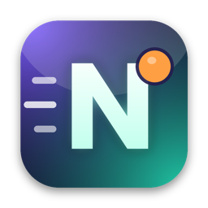

# shipyard

Central repository for publishing application builds. Each app lives in its own folder with a download page, so builds can be shared with a single link.

Site: <https://veynora.github.io/shipyard/> (GitHub Pages, served from the `main` branch)

## Apps

| App | Platform | Version | Download page |
|---|---|---|---|
| **Nudge** | macOS 11+, Apple Silicon | 1.0.0 | <https://veynora.github.io/shipyard/nudge/> |

## Nudge



A reminder companion for your Mac. When a reminder is due, an animated 3D character appears in the window you're working in (including full-screen apps and other Spaces) and tells you what to do.

**Features**
- Reminder appears where you are, without stealing focus
- One-step resolve: done, snooze, or type a phrase like "after lunch" or "friday 5pm"
- Six characters (Robot, Nova, Raven, Scarlet, Elara, Valkyrie) and your own `.glb` models
- Personality voices, optional spoken reminders, recurring reminders, brain-dump entry
- Google Calendar and ICS import
- Menu-bar app that works offline; data stays on your Mac in `~/.nudge/`
- Optional AI-written wording with your own Anthropic API key (Settings)

**Download**
- Direct: [`nudge/Nudge-1.0.0.dmg`](nudge/Nudge-1.0.0.dmg) (51 MB)
- Checksum: [`nudge/Nudge-1.0.0.dmg.sha256`](nudge/Nudge-1.0.0.dmg.sha256)
  ```sh
  shasum -a 256 ~/Downloads/Nudge-1.0.0.dmg   # must match the .sha256 file
  ```

**Install**
1. Open the DMG and drag **Nudge** into **Applications**.
2. First launch: right-click Nudge → **Open** → **Open**. The build is ad-hoc signed and not yet notarized by Apple, so macOS asks once.
3. If macOS still blocks it:
   ```sh
   xattr -dr com.apple.quarantine /Applications/Nudge.app
   ```
4. Look for the **N** in the menu bar.

**Requirements**: macOS 11 or later, Apple Silicon (M-series). Intel Macs are not supported in this build.

**Uninstall**: quit Nudge, delete `Nudge.app`, and optionally delete `~/.nudge/` (reminders, settings, logs).

## Repository layout

```
shipyard/
├── README.md              this file
└── nudge/
    ├── index.html         download page (GitHub Pages)
    ├── icon.png           page logo
    ├── favicon.png        page favicon
    ├── Nudge-1.0.0.dmg    installer
    └── Nudge-1.0.0.dmg.sha256
```

## Publishing a new build

1. Build the app and DMG in the source project (`development/nudge/dmg-build`, run `make all`).
2. Copy the DMG into the app's folder here and write its checksum:
   ```sh
   cp .../dist/Nudge-<version>.dmg nudge/
   (cd nudge && shasum -a 256 Nudge-<version>.dmg > Nudge-<version>.dmg.sha256)
   ```
3. Update the version, file name, size and SHA-256 in `nudge/index.html` and in the table above.
4. Commit and push to `main`. The page updates within a couple of minutes.

> Each DMG committed adds roughly 50 MB to the repo history, and GitHub rejects single files over 100 MB. For frequent releases, consider attaching DMGs to GitHub Releases and pointing the download button there.

## Adding another app

Create a new folder (for example `myapp/`) with its own `index.html` and build files, then add a row to the Apps table. It will be served at `https://veynora.github.io/shipyard/myapp/`.
