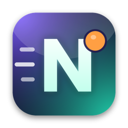

# Nudge



A reminder you can't miss and don't mind. When a reminder is due, an animated 3D character appears in the window you're working in and tells you what to do. You can finish it, skip it, push it back in plain language ("after lunch", "friday 5pm"), or shrink it to a tiny first step.

Everything stays on your computer: no account and no server. Latest version: **2.3.0** (macOS 11+, Windows 10/11).

Download page: <https://veynora.github.io/shipyard/nudge/> · [Back to Shipyard](../README.md)

## What Nudge can do

**Reminders**
- Add them in everyday words: "in 20 min", "tomorrow 9am", "tonight", "every weekday 9am", "every 2 hours".
- Start from a template (Drink water, Stretch break, Stand up, Take medicine, Wind down, Review my day) and edit any reminder later, including calendar ones. *(2.1)*
- Paste a messy brain dump and let Nudge pull out the tasks and times.
- Priorities (Low, Normal, High) and repeats with active hours. High priority comes back every 2 minutes, up to 10 times; Normal once after 10 minutes. *(2.0)*
- Done, snooze, **Skip** ("not this time": no snooze, a repeating reminder moves to its next time), or split into a tiny first step. *(Skip: 2.1)*

**The popup and the characters**
- Appears on the screen you're working on, including a second monitor, and is no longer hidden by the dashboard or a full-screen app on macOS. *(2.2)*
- Several reminders at once sit side by side, with "+N waiting" if the screen is full. Reminders due while your Mac is locked wait and appear, with their character, when you're back. *(2.3)*
- Eight characters (Aria, Celeste, Elara, Luna, Nova, Raven, Scarlet, Valkyrie) and four personalities (calm coach, sarcastic friend, sports commentator, movie hero). Reminders can be spoken aloud.

**Dashboard and settings**
- A dashboard with what is due today, overdue, upcoming, snoozed 3+ times, and done and skipped in the last 7 days; Light, Dark or Auto theme; a Settings page with a Save button per card. *(2.0, 2.1)*
- Weekly reflection, plus a menu-bar (Mac) or system-tray (Windows) menu with Pause reminders for 30 minutes, 1 hour, 2 hours or until tomorrow. *(Pause: 2.1)*

**Calendars**
- Google Calendar and any number of ICS links, each with its own name, look-ahead and several reminders per meeting (for example 1 day, 1 hour, 10 minutes and at the start). Spoken meeting reminders say how long is left. *(2.1)*
- Optionally add your Nudge reminders to Google Calendar.

**Optional AI wording:** add your own Anthropic API key in Settings for freshly written reminder messages. Without a key, built-in wording is used.

## What's new

| Version | Date | New things | Notes |
|---|---|---|---|
| 2.3.0 | 2026-11-18 | Popups side by side, lock-screen fix, Robot removed | [Release notes](v2.3.0/release-notes.html) |
| 2.2.0 | 2026-10-19 | Popup on the screen you work on (second monitor), over full-screen apps | [Release notes](v2.2.0/release-notes.html) |
| 2.1.0 | 2026-10-18 | Templates, Skip, multiple calendars, macOS menu bar | [Release notes](v2.1.0/release-notes.html) |
| 2.0.0 | 2026-10-17 | Rust/Tauri rewrite, Dashboard, themes, Settings page, 8 characters | [Release notes](v2.0.0/release-notes.html) |
| 1.0.0 | 2026-10-16 | First official prototype (Python) | [Release notes](v1.0.0/release-notes.html) |

## Download (2.3.0)

| Platform | File | Size | Checksum |
|---|---|---|---|
| macOS, Apple Silicon | [`v2.3.0/Nudge-2.3.0-arm64.dmg`](v2.3.0/Nudge-2.3.0-arm64.dmg) | 24 MB | [`.sha256`](v2.3.0/Nudge-2.3.0-arm64.dmg.sha256) |
| macOS, Intel | [`v2.3.0/Nudge-2.3.0-x64.dmg`](v2.3.0/Nudge-2.3.0-x64.dmg) | 24 MB | [`.sha256`](v2.3.0/Nudge-2.3.0-x64.dmg.sha256) |
| Windows, 64-bit | [`v2.3.0/Nudge-2.3.0-x64.exe`](v2.3.0/Nudge-2.3.0-x64.exe) | 20 MB | [`.sha256`](v2.3.0/Nudge-2.3.0-x64.exe.sha256) |
| Windows, ARM64 | [`v2.3.0/Nudge-2.3.0-arm64.exe`](v2.3.0/Nudge-2.3.0-arm64.exe) | 20 MB | [`.sha256`](v2.3.0/Nudge-2.3.0-arm64.exe.sha256) |

Older versions are in their own `vX.Y.Z/` folders (see [What's new](#whats-new)). Check a download against its `.sha256` file:

```sh
shasum -a 256 ~/Downloads/Nudge-2.3.0-arm64.dmg   # must match the .sha256 file
```
```powershell
Get-FileHash $HOME\Downloads\Nudge-2.3.0-x64.exe -Algorithm SHA256   # must match the .sha256 file
```

## Install

**macOS**
1. Open the DMG for your Mac (arm64 for Apple Silicon, x64 for Intel) and drag **Nudge** into **Applications**.
2. First launch: right-click Nudge → **Open** → **Open**. The build is ad-hoc signed and not yet notarized by Apple, so macOS asks once.
3. If macOS still blocks it:
   ```sh
   xattr -dr com.apple.quarantine /Applications/Nudge.app
   ```
4. Look for the **N** in the menu bar.

**Windows**
1. Run `Nudge-2.3.0-x64.exe` (`-arm64` on ARM PCs). The build is not code-signed yet, so if SmartScreen says "Windows protected your PC", click **More info** → **Run anyway**.
2. Finish the installer (per user, no administrator rights needed).
3. Needs the Edge **WebView2 Runtime** (included with current Windows 10/11; the installer downloads it if missing).
4. Look for the **N** in the system tray.

**Requirements:** macOS 11 or later (Apple Silicon or Intel); or Windows 10/11 (x64 or ARM64).

**Uninstall:** macOS: quit Nudge, delete `Nudge.app`. Windows: Settings → Apps → Nudge → Uninstall. Optionally delete `~/.nudge/` (`%USERPROFILE%\.nudge` on Windows) for reminders, settings and logs.

## Known limitations

From the 2.3.0 release notes and the ones before it:
- The Windows installers and the Intel Mac build have not been installed or run on real machines.
- The popup layout, the lock-screen behaviour and the second-monitor and full-screen fixes were checked with automated tests and code review, not yet by eye on real hardware.
- macOS builds are not notarized and Windows builds are not code-signed, so macOS and SmartScreen ask once. There is no auto-update yet: install a new version over the old one.
- Templates are built in (you can't save your own), and the Anthropic API key is stored in plain text in `~/.nudge/.env` (owner-only permissions).
- Linux and mobile are not built.

## Folder layout

```
nudge/
├── README.md              this file
├── index.html             download page (GitHub Pages)
├── icon.png  favicon.png  page logo and favicon
└── vX.Y.Z/                one folder per version (v2.3.0 … v1.0.0)
    ├── Nudge-X.Y.Z-{arm64,x64}.{dmg,exe}   installers, each with a .sha256 file
    └── release-notes.html                  release notes page
```
(1.0.0 has one `.dmg` and one `.exe`: `Nudge-1.0.0.dmg` and `Nudge-1.0.0.exe`.)

## Publishing a new build

1. Build the installers in the source project (`applications/nudge/build`): `make -C dmg` (macOS arm64 + x64) and `make -C exe` (Windows x64 + ARM64). They land in `applications/nudge/releases/vX.Y.Z/` together with `RELEASE_NOTES.md`.
2. From the Shipyard root, copy them into a new version folder with hyphenated names, write checksums and make the notes page:
   ```sh
   V=2.3.0; R=../applications/nudge/releases/v$V
   mkdir nudge/v$V
   for a in arm64 x64; do
     cp $R/Nudge_${V}_$a.dmg nudge/v$V/Nudge-$V-$a.dmg
     cp $R/Nudge_${V}_$a.exe nudge/v$V/Nudge-$V-$a.exe
   done
   (cd nudge/v$V && for f in Nudge-$V-*; do shasum -a 256 $f > $f.sha256; done)
   python3 ../applications/nudge/build/notes_html.py $R/RELEASE_NOTES.md nudge/v$V/release-notes.html
   ```
3. Do this on a branch and open a PR into `main`.
4. Update `index.html`: add one entry to the `RELEASES` array in its Downloads script (version, and per platform file `name`, `size` and `sha256`; no date, the release notes carry it). The page shows the newest 3 versions and moves older ones into "Older versions (N)" by itself, and builds the Notes links, checksums and verify hints from that data. Also add a card to "What's new". Then update this README: the "What's new" table, the Download table, and the checksum examples. Never overwrite an existing version's folder.
5. Merge to `main`. The page updates within a couple of minutes.

> Each release adds roughly 85 MB (four installers at about 20 MB each) to the repo history, and GitHub rejects single files over 100 MB. For frequent releases, consider attaching DMGs to GitHub Releases and pointing the download button there.
